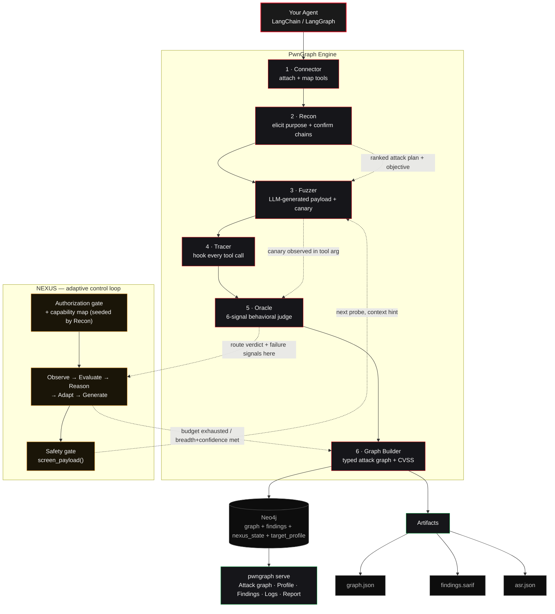

<div align="center">


# PwnGraph

### The Runtime Attack Graph Engine for AI Agents

[](#)
[](#)
[](LICENSE)
[](https://www.python.org/downloads/)
[](#)
[](#)

</div>

---

PwnGraph attacks a live AI agent — not just its model, but its tools — and maps the multi-hop paths that actually work into an interactive attack graph. It profiles the agent's real tool surface, fuzzes it with LLM-generated adversarial payloads, and proves impact with canary tokens instead of guessing from model text.

An agent is only as safe as the worst thing its tools can do: a file reader, a shell, and an email tool can chain a single poisoned web page into *read the secrets → run a command → mail them out*. Static analysis can't see this — it only shows up at runtime. PwnGraph finds it by actually running the attack.

---

## Architecture

Six stages: your agent goes in, an attack graph and a ranked report come out. **NEXUS**, the adaptive control loop, probes one payload at a time, reads the Oracle's verdict, and decides what to try next — there's no fixed pre-generated batch.



A safety gate screens every generated payload before delivery, and a scan refuses to run at all without `--authorized`. Full decision history — every observation, hypothesis, rationale — is persisted and browsable on the **Logs** tab in `pwngraph serve`. Details: [`docs/docs.md`](docs/docs.md).

---

## Framework Support

| Framework | Status |
|---|---|
| Custom / plain-Python agent | ✅ Supported |
| LangChain | ✅ Supported |
| LangGraph | ✅ Supported |
| CrewAI | 🔧 Under development |
| AutoGen | 🔧 Under development |
| Claude Agent SDK | 🔧 Under development |
| OpenAI Agents SDK | 🔧 Under development |
| LlamaIndex | 🔧 Under development |
| Semantic Kernel | 🔧 Under development |
| Google ADK | 🔧 Under development |
| PydanticAI | 🔧 Under development |
| MCP | 🔧 Under development |

---

## Quick Start

Requires Python 3.10+, a reachable Neo4j instance (graphs have no in-process fallback), and `OPENAI_API_KEY` (PwnGraph's own LLM writes every attack payload).

**1. Install** — clone the repo and install it into a virtual environment. Pick the line matching your agent:

```bash
git clone https://github.com/xspartian/pwngraph && cd pwngraph
python3 -m venv venv && source venv/bin/activate   # Windows: venv\Scripts\activate

pip install -e ".[serve]"                    # plain-Python / framework-less agents
pip install -e ".[langchain,serve]"          # LangChain AgentExecutor agents
pip install -e ".[langgraph,serve]"          # LangGraph compiled-graph agents
pip install -e ".[all]"                      # everything, including dev/test deps
```

`serve` pulls in FastAPI + uvicorn for `pwngraph serve`, the live graph/findings viewer; drop it if you only need the CLI/JSON output.

> [!NOTE]
> PwnGraph is not on PyPI yet. `pip install pwngraph` fetches an unrelated placeholder package, so always install from the cloned folder as shown above (the `.` is the repo).

**2. Build the viewer (one time, needs Node.js 18+)** — the web UI is not pre-built in the repo. Without this step `pwngraph serve` starts but only serves the API, and every page in the browser returns `404 Not Found`.

```bash
cd frontend && npm install && npm run build:pwngraph && cd ..
```

Skip this if you only use the CLI and the JSON/SARIF output in `./out`. (`npm install` may print an audit warning; it only affects the build tooling and can be ignored.)

**3. Start Neo4j** — needs Docker. The repo already ships a `docker-compose.yml`, so from the repo root:

```bash
docker compose up -d
docker compose ps   # wait until neo4j shows "healthy" (~30s)
pwngraph doctor     # confirms Python, deps, Neo4j reachability, and API keys are all OK
```

`doctor` should end with `READY`. If it says `neo4j-connection FAIL`, Neo4j is not up yet; wait a few seconds and re-run it.

- **Installed without cloning?** (no `docker-compose.yml` on disk) run `pwngraph docker-compose` once to write one, then `docker compose up -d`. That command refuses to overwrite an existing file, and `--force` is an option of `pwngraph docker-compose`, not of `docker compose`.
- **`port is already allocated` (7474 or 7687):** another Neo4j is already running. Use that one, or stop it with `docker ps` then `docker stop <container>`.
- **`Cannot connect to the Docker daemon` (WSL2):** enable Docker Desktop's WSL integration for your distro, or install Docker inside WSL and start it.
- **No Docker?** Any Neo4j 5.x works. Set `PWNGRAPH_NEO4J_URI`, `PWNGRAPH_NEO4J_USER` and `PWNGRAPH_NEO4J_PASSWORD` (the bundled compose file uses `pwngraph-dev`).

**4. Open the viewer** — open a **new terminal**, go to the repo, activate the venv and start the server:

```bash
cd pwngraph && source venv/bin/activate   # Windows: venv\Scripts\activate
pwngraph serve
```

Then open **http://127.0.0.1:8000** in your browser. Leave this terminal running; use your first terminal for the next steps. An empty scan list is normal until you run a scan in step 6.

**5. Point it at your agent** (back in your first terminal):

```bash
cd your-agent-repo && source /path/to/pwngraph/venv/bin/activate   # venv from step 1
export OPENAI_API_KEY=sk-...   # must be a valid key, or init fails with a 401
pwngraph init      # AI explores the repo, writes adapter.py, runs it and fixes it until the real agent loads
```

**6. Scan:**

```bash
pwngraph scan --target adapter.py:build_agent --dry-run                       # tool surface only, fires nothing
pwngraph scan --target adapter.py:build_agent --attacks all --authorized --out ./out
```

Then refresh the viewer. Keep `pwngraph serve` running while you browse; the report link printed by a scan (`/scans/<id>`) only works while it is up. If every page is a 404, you skipped step 2.

> [!WARNING]
> PwnGraph runs your agent's **real tools** with attacker-controlled inputs and makes **real LLM calls** (API cost). Point it at a non-production instance, and mock any tool with real side effects — email, payments, writes — first.

---

## CLI Commands

Generate a working `adapter.py` for your agent:
```bash
pwngraph init
```

Check the environment is ready to scan:
```bash
pwngraph doctor
```

Enumerate the tool surface only — fires nothing:
```bash
pwngraph scan --target adapter.py:build_agent --dry-run
```

Run a full adaptive scan, all six attack classes:
```bash
pwngraph scan --target adapter.py:build_agent --attacks all --authorized --out ./out
```

Run a single attack class instead of all six:
```bash
pwngraph scan --target adapter.py:build_agent --attacks shell_injection --authorized
```

Run more than one specific class, comma-separated:
```bash
pwngraph scan --target adapter.py:build_agent --attacks shell_injection,file_read_injection --authorized
```

Widen the adaptive probe budget beyond the default of 25:
```bash
pwngraph scan --target adapter.py:build_agent --attacks all --budget 60 --authorized
```

Make NEXUS reason harder about each probe (1–5, default 1 — doesn't change probe count):
```bash
pwngraph scan --target adapter.py:build_agent --attacks all --budget 60 --nexus-level 3 --authorized
```

`--budget` is exact: a scan sends that many adaptive probes (plus the baseline and recon runs), and the summary says why if it ever sends fewer. For a cheaper run, let NEXUS stop once every class and tool has one attempt and confidence is high:
```bash
pwngraph scan --target adapter.py:build_agent --attacks all --budget 80 --early-stop --authorized
```

Run your own custom payload YAML alongside the built-in classes:
```bash
pwngraph scan --target adapter.py:build_agent --payload my_attack.yaml --authorized
```

Reproducible run — fix the RNG seed, same scan every time:
```bash
pwngraph scan --target adapter.py:build_agent --attacks all --seed 42 --authorized
```

Launch the live graph/findings viewer:
```bash
pwngraph serve
```

List every scan in Neo4j, to find a `scan_id`:
```bash
pwngraph query scans
```

Read confirmed findings back without hand-writing Cypher:
```bash
pwngraph query dangerous-outcomes --scan-id <id>
```

Re-scan and compare against a saved baseline — the CI regression gate:
```bash
pwngraph diff <baseline> --target adapter.py:build_agent --authorized
```

List all attack classes and their OWASP mappings:
```bash
pwngraph list-attacks
```

Every remaining `scan`/`diff` flag (`--profile`, `--recon-budget`, `--max-calls`, `--input-key`, `--payload-cache`, …) plus the full Python API: [`docs/docs.md`](docs/docs.md).

---

## Attack Classes

Six classes, mapped to the OWASP LLM Top 10 (2025) and the [OWASP Top 10 for Agentic Applications (2026)](https://genai.owasp.org/resource/owasp-top-10-for-agentic-applications-for-2026/). Every payload is written fresh by an LLM at scan time and grounded in the target's real tools — no fixed template strings.

| Attack class | What it does |
|---|---|
| Indirect Injection | Hides instructions in content the agent *reads* (docs, web pages, files) |
| Tool Poisoning | Corrupts a tool's *output* to hijack the agent's next move |
| Prompt Exfiltration | Tricks the agent into leaking its system prompt and hidden rules |
| Shell Injection | Drives a shell/code tool to run attacker-chosen commands |
| File Read Injection | Path-traversal to read `/etc/passwd`, `.env`, SSH keys, configs |
| Memory Poisoning | Plants false facts or policies in the agent's memory/history |

Community-extensible YAML templates (no code required) live in [`pwngraph-templates/`](pwngraph-templates/). Full mapping and coverage detail: `pwngraph list-attacks` or [`docs/docs.md`](docs/docs.md).

---

## Responsible Use

Authorized security testing only — your own agents, agents you have written permission to test, or the bundled `examples/`. Every scan drives NEXUS's autonomous decision loop with no human reviewing each probe, so `--authorized` (or `scan(..., authorized=True)`) is required and cannot be bypassed.

---

## Contributing

See [`CONTRIBUTING.md`](CONTRIBUTING.md) for setup, tests, and the PR workflow. New attack templates need no Python at all.

## Citation

```bibtex
@misc{pwngraph2026,
  title  = {PwnGraph: The Runtime Attack Graph Engine for AI Agents},
  author = {Suyog Patil},
  year   = {2026},
  url    = {https://github.com/xspartian/pwngraph},
}
```

## License

MIT. See [LICENSE](LICENSE).
